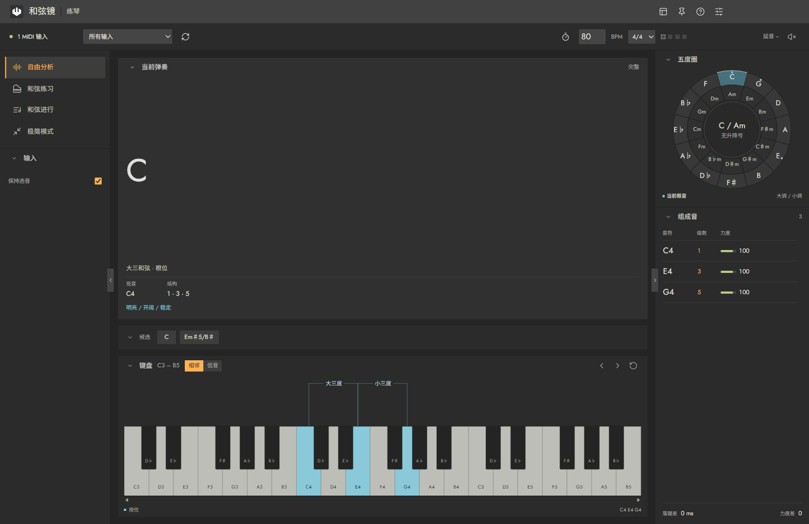

# 和弦镜 · 练琴

Windows MIDI 和弦分析与练琴桌面工具。接入键盘即接收 MIDI，声音与 MIDI 试听默认开启，数据保存在本机。



## 下载

从 [Releases](https://github.com/TheycallmeXH/chord-lens-practice/releases) 下载 Windows x64 压缩包，完整解压后运行 `和弦镜练琴版.exe`。移动应用时保留整个文件夹。无需安装 Node.js 或启动服务器。

Windows 可能提示发布者未知：当前版本未做代码签名。

## 功能

- 实时和弦名、候选、转位、实际组成音、力度、低音、音程与定性听感。
- 5 级、15 类、32 种和弦练习，可指定和弦与转位，支持超时按键提示。
- 18 套可移调和弦进行，支持共同音衔接、就近转位与重练本轮。
- 导入标准 MIDI 文件，选择音轨、预览并生成和弦进行练习。
- 任意八度或指定音区判定，支持踏板。
- 五度圈、键盘上方的相邻 / 低音音程关系、面板折叠与边缘侧栏开关。
- 可缩放的极简窗口、窗口置顶、无声节拍器、练习记录与 JSON 导出。
- 自动连接 MIDI、设备热插拔、通道筛选、断开清音、损坏记录恢复。
- 设置内切换 Live 黑、Live 白、FL Studio、Cubase、Medly 五套配色，记住上次选择，标题栏与极简窗口同步。
- 自定义九项界面与琴键颜色，实时预览，命名保存、修改、复制和删除，最多保存 24 套。
- 内置 Akai Steinway SF2 采样钢琴，支持力度、踏板和参考音调音；设置内可更换 SF2 文件，记住选择。

各模式只显示当前可用功能。自由分析隐藏练习目标、参数、成绩、记录与下一题，保留分析和输入工具。琴键固定为 128 px，小窗口为 104 px；音符与和弦长度变化不改变面板高度。

## 操作

空格开始或暂停，Escape 清音。`A W S E D F T G Y H U J K` 对应 C4–C5；也可点击屏幕琴键。开启“保持选音”后再次点击松开。

练习默认正确保持 350 ms，保持时间可调整。和弦练习需全部松键切题；和弦进行默认允许保留共同音衔接，也可设置为全部松键切题。默认计入踏板延音。清音不记错误，暂停不计用时。进入极简模式会暂停练习，返回后手动继续。

每次启动总声音与外接 MIDI 试听默认开启，可分别关闭。节拍器可以只闪拍。软件不读取麦克风或系统音频。

桌面发行版默认挂载 `akai_steinway.sf2` 的 `piano1`，启动时加载采样；随后开关声音复用音色，关闭声音会停止尾音并暂停音频处理。目标试听与实时弹奏使用独立通道。
音色通过本机文件流读取，减少跨进程复制；采样解码缓存限制为 32 MB。空闲时自动暂停音频处理，下次按键、试听或开启节拍器时恢复。

MIDI 导入支持 Format 0 / 1、每拍 ticks、最大 16 MB。按起音时间窗或拍长分组，忽略打击乐与不足三个音级的组；这是和弦练习提取，不包含旋律自动配和声或节奏评分。导入文件按原音区生成目标，重启应用后需重新导入。

设置的“关于”面板显示版本、作者 Katuria、项目仓库与可查看的完整授权文本。

记录保存于当前 Windows 用户的应用数据目录，保留最近 100 轮。更新应用不会主动删除记录。程序不上传 MIDI 或练习记录。

## 开发

需要 Windows x64、Node.js 24 或更新的兼容版本。依赖版本锁定在 `desktop/package-lock.json`。

```powershell
cd desktop
npm ci
npm start
npm test
npm run test:ui
npm run test:themes
npm run build
npm run test:desktop
npm run test:soundfont
```

`test:ui` 默认使用已安装的 Microsoft Edge，也可通过 `CHORD_LENS_BROWSER` 指定 Chromium 浏览器路径。原生测试使用独立测试记录目录，不读取日常练习记录。`test:desktop` 需先构建，测试期间会显示窗口。

构建产物位于 `dist/和弦镜练琴版/`，应分发完整目录。公开源码与发布包使用 Jost（SIL OFL 1.1），优先使用用户本机已有的 Ableton Sans。仓库不包含 Ableton 字体，不隶属于 Ableton。

## 识别边界

识别基于 Tonal 字典及实际 MIDI 音集。保留八度、实际低音与候选解释；无调性上下文时，同一音集可能有多个合理名称。省略五音解释会明确标为推测，推测音不会添加到实际组成音表中。练习判定直接比较音高，不依赖候选名称排序。

情绪是定性听感提示，不是情绪预测，也不是对全部延伸和弦的实验性结论。文化、音区、配器与上下文会改变听感。详细依据见 [研究与方法](docs/references.md)，测试范围见 [发布验证](docs/validation.md)。

项目代码采用 MIT 许可证，第三方组件见 [授权声明](THIRD_PARTY_NOTICES.md)。
